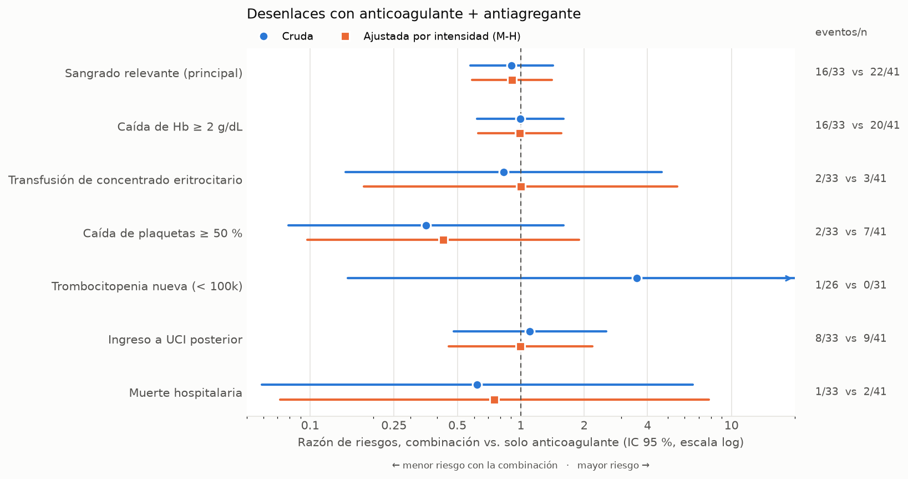

# Anticoagulante + antiagregante en el hospital

[](https://github.com/antonio-velazquezr/BiomedicalDataScience_FinalProyect/actions/workflows/ci.yml)

Estudio de farmacovigilancia (Modalidad A del proyecto final del curso de ciencia de datos en salud)
sobre el **efecto conjunto de anticoagulantes y antiagregantes** en pacientes hospitalizados.

> **Estado:** en desarrollo. La cohorte, los desenlaces y el análisis descriptivo ya están implementados
> y probados (74 pacientes: 33 con la combinación y 41 con solo anticoagulante). Faltan los análisis de
> sensibilidad y la conversión a OMOP.

## Resultados principales

Reporte completo en [resultados/resultados.md](resultados/resultados.md).



- **Sangrado relevante:** 48 % con la combinación vs. 54 % con solo anticoagulante.
  RR crudo 0.90 (IC 95 % 0.57–1.42); RR ajustado por intensidad (Mantel-Haenszel) 0.91 (0.59–1.40).
  Los datos son compatibles tanto con una reducción del 40 % como con un aumento del 40 %: **no permiten
  concluir que haya o no haya diferencia**.
- **Por intensidad:** con profilaxis, RR 1.08 (0.66–1.77). El estrato terapéutico (9 vs. 5 pacientes) es
  demasiado pequeño para interpretarse.
- **Plaquetas:** la combinación no se asoció con más caídas de plaquetas, lo que es coherente con la
  farmacología (los antiagregantes inhiben la función plaquetaria, no la cuenta).
- **Los grupos no son comparables al inicio.** La combinación tiene pacientes mayores (66 vs. 55 años),
  con más cardiopatía isquémica (48 % vs. 15 %) y fibrilación auricular (39 % vs. 20 %). El comparador
  está más en UCI en la fecha índice (66 % vs. 42 %), donde las flebotomías y la hemodilución bajan la
  Hb por sí mismas. Varias diferencias estandarizadas superan 0.4, así que los riesgos crudos no deben
  leerse como efecto causal.

## Pregunta

En pacientes hospitalizados que reciben un anticoagulante, ¿**añadir un antiagregante** se asocia con
más sangrado y con peores desenlaces hospitalarios? El análisis se estratifica por la intensidad de la
anticoagulación (profiláctica vs. terapéutica).

Detalle en [docs/propuesta.md](docs/propuesta.md).

## Diseño

| Elemento | Definición |
|---|---|
| **Fuente** | MIMIC-IV Clinical Database Demo v2.2 (100 pacientes) |
| **Población** | Adultos con estancia ≥ 24 h que reciben un anticoagulante (profiláctico o terapéutico) durante la hospitalización. Se toma la primera hospitalización elegible por paciente |
| **Exclusiones** | Hospitalizaciones cuyo diagnóstico principal es un sangrado; pacientes sin plaquetas o Hb basales |
| **Grupo expuesto** | Anticoagulante **+ antiagregante** (aspirina o inhibidor P2Y12) con solapamiento temporal. Fecha índice: inicio del primer solapamiento |
| **Grupo comparador** | Anticoagulante **sin** antiagregante en toda la hospitalización. Fecha índice: inicio del anticoagulante |
| **Estratos** | Intensidad del anticoagulante en la fecha índice: profiláctica / terapéutica |
| **Basal** | Último valor en las 48 h previas a la fecha índice |
| **Seguimiento** | Desde la fecha índice hasta el alta o el día 14, lo que ocurra primero |

## Qué se mide

### Desenlace principal: sangrado clínicamente relevante

Se cumple con cualquiera de estas dos condiciones durante el seguimiento:
- caída de hemoglobina ≥ 2 g/dL respecto a la basal (umbral del criterio ISTH de sangrado mayor), o
- transfusión de concentrado eritrocitario.

### Desenlaces secundarios

| Dominio | Variable |
|---|---|
| Sangrado | Cada componente por separado; caída máxima de Hb (basal − nadir, en g/dL) |
| Plaquetas (seguridad) | Cambio porcentual basal → nadir; trombocitopenia nueva (< 100 × 10⁹/L con basal ≥ 150); caída ≥ 50 % |
| Hospitalarias | Estancia desde la fecha índice (días); ingreso a UCI posterior a la fecha índice; mortalidad hospitalaria |

Las plaquetas son una variable **secundaria**. Los antiagregantes inhiben la *función* plaquetaria, no
el *número* de plaquetas, así que la combinación no debería bajar la cuenta. Una caída de la cuenta
apunta más a la heparina, la cirugía o la sepsis.

### Covariables (Tabla 1)

Edad, sexo, estrato clínico (médico / quirúrgico / cirugía cardiaca), estancia en UCI al momento de la
fecha índice, fibrilación auricular, cardiopatía isquémica, tromboembolia venosa, insuficiencia cardiaca,
plaquetas y Hb basales.

### Análisis

- Descripción por grupo y por estrato de intensidad.
- Riesgo de cada desenlace binario con IC 95 % (Wilson); diferencia y razón de riesgos con IC 95 %.
- Razón de riesgos combinada entre estratos (Mantel-Haenszel).
- Variables continuas: mediana y rango intercuartílico.
- Tabla de atrición.

### Análisis de sensibilidad

- Exposición por administración real (`emar`) en lugar de prescripción
- Seguimiento de 7 días en lugar de 14
- Excluir la cirugía cardiaca
- Desenlace solo por laboratorio (sin transfusión)

### Limitaciones previstas

- **Confusión por indicación:** quienes reciben la combinación suelen tener fibrilación auricular y
  cardiopatía isquémica a la vez. Se describe en la Tabla 1, pero no se puede eliminar con esta *n*.
- **Tamaño:** 33 pacientes expuestos y 41 comparadores. Los resultados son descriptivos y exploratorios.
- **Transfusión:** solo está registrada en UCI (`inputevents`).
- **Fuente:** un solo centro de tercer nivel; no se ve la medicación previa al ingreso.

## Datos

Este repositorio **no contiene datos**. Para reproducir el trabajo:

1. Descarga *MIMIC-IV Clinical Database Demo* **v2.2** desde PhysioNet
   (<https://physionet.org/content/mimic-iv-demo/2.2/>). El acceso es abierto y la licencia es ODbL.
2. Descomprime el archivo en `data/raw/`, de modo que quede `data/raw/mimic-iv-clinical-database-demo-2.2/`.
3. Verifica la integridad con `sha256sum -c SHA256SUMS.txt` dentro de esa carpeta.

## Entorno

### Opción A: Docker (recomendada)

Requiere Docker con Compose. Los datos no se copian a la imagen: se montan desde `./data`.

```bash
docker compose build
```

```bash
docker compose run --rm analisis
```

```bash
docker compose run --rm analisis pytest
```

El primer comando construye la imagen, el segundo corre la cohorte y el análisis completo (requiere los
datos en `data/raw/`) y el tercero corre las pruebas.

### Opción B: entorno virtual local

```bash
python -m venv .venv
.venv/Scripts/python -m pip install -c constraints.txt -e ".[dev]"
```

`constraints.txt` fija las versiones exactas con las que se desarrolló y probó el proyecto
(Python 3.12/3.13, DuckDB 2.0, polars 2.1).

### Integración continua

En cada push, [GitHub Actions](.github/workflows/ci.yml) corre las pruebas en Python 3.12 y 3.13,
verifica que no se haya versionado ningún archivo de datos, construye la imagen Docker y repite las
pruebas dentro de ella. Las pruebas usan datos sintéticos, así que no requieren MIMIC.

## Cómo correrlo

```bash
python -m antitromboticos.cohorte
```

Construye la cohorte y los desenlaces en DuckDB a partir de los scripts de `sql/` y escribe la tabla de
atrición en `resultados/atricion.csv`. La definición está en [docs/cohorte.md](docs/cohorte.md).

```bash
python -m antitromboticos.analisis
```

Reconstruye la cohorte y genera la Tabla 1, los desenlaces (`resultados/*.csv` y `resultados/resultados.md`)
y el forest plot (`figuras/07_forest_rr.png`).

Pruebas (usan datos sintéticos, no requieren MIMIC):

```bash
python -m pytest
```

## Estructura

```
.github/workflows/    integración continua
Dockerfile, compose.yml
sql/                  conjuntos de fármacos y cohorte (DuckDB)
src/antitromboticos/  código del pipeline
tests/                pruebas con datos sintéticos
docs/                 propuesta, definición de cohorte
resultados/           tablas agregadas (sin datos individuales)
notebooks/            exploración (no es lógica de producción)
figuras/              figuras generadas
```

## Uso de asistentes de IA

En la planeación, la exploración de datos, el código y la redacción se usó Claude Code (Anthropic).
Todas las decisiones de diseño y su interpretación son responsabilidad del autor.
