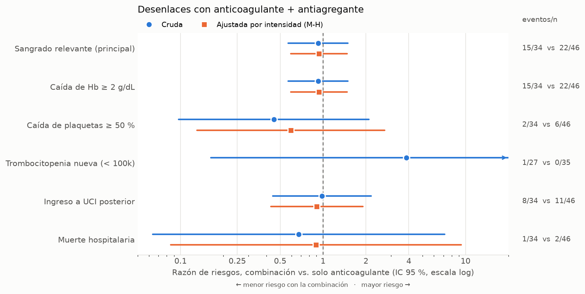

# Resultados (omop)

Fuente: MIMIC-IV demo en OMOP CDM 5.3.1 (v0.9). Sin transfusiones: el sangrado relevante es solo la caída de Hb ≥ 2 g/dL. Sin exclusión por diagnóstico principal de sangrado. Ver docs/omop.md.

Generado por `python -m antitromboticos.analisis --fuente omop`. Combinación = anticoagulante + antiagregante; comparador = solo anticoagulante. |DME| = diferencia de medias estandarizada (> 0.10 sugiere desbalance). Riesgos con IC de Wilson; diferencia con IC de Wald; RR con IC logarítmico (corrección de Haldane si un grupo tiene 0 eventos); RR de Mantel-Haenszel combinado entre estratos de intensidad.

## Tabla 1. Características basales

| Característica | Combinación | Solo anticoagulante | |DME| |
|---|---|---|---|
| n | 34 | 46 |  |
| Edad, años | 66.0 [60.8–78.0] | 56.5 [47.2–71.8] | 0.51 |
| Mujeres | 13 (38 %) | 25 (54 %) | 0.33 |
| Estrato: médico | 13 (38 %) | 22 (48 %) | 0.19 |
| Estrato: quirúrgico | 12 (35 %) | 19 (41 %) | 0.12 |
| Estrato: cirugía cardiaca | 9 (26 %) | 5 (11 %) | 0.41 |
| En UCI en la fecha índice | 14 (41 %) | 29 (63 %) | 0.45 |
| Anticoagulación terapéutica | 11 (32 %) | 5 (11 %) | 0.54 |
| Anticoagulante: HNF | 29 (85 %) | 44 (96 %) | 0.36 |
| Anticoagulante: Enoxaparina | 1 (3 %) | 0 (0 %) | 0.25 |
| Anticoagulante: Warfarina | 4 (12 %) | 1 (2 %) | 0.38 |
| Anticoagulante: DOAC | 0 (0 %) | 1 (2 %) | 0.21 |
| Fibrilación auricular | 13 (38 %) | 9 (20 %) | 0.42 |
| Cardiopatía isquémica | 17 (50 %) | 8 (17 %) | 0.73 |
| Tromboembolia venosa | 1 (3 %) | 3 (7 %) | 0.17 |
| Insuficiencia cardiaca | 7 (21 %) | 7 (15 %) | 0.14 |
| Plaquetas basales (×10⁹/L) | 218.5 [170.0–265.5] | 201.0 [154.8–308.8] | 0.17 |
| Hb basal (g/dL) | 12.1 [10.8–13.8] | 11.6 [10.6–13.1] | 0.41 |
| Días de seguimiento | 5.3 [3.8–9.4] | 7.3 [3.8–10.8] | 0.22 |

## Tabla 2. Desenlaces binarios

| Desenlace | Estrato | Combinación, % (IC 95 %) | Solo AC, % (IC 95 %) | Diferencia, pp (IC 95 %) | RR (IC 95 %) |
|---|---|---|---|---|---|
| Sangrado relevante (principal) | Todos | 44 % (29–61) | 48 % (34–62) | -4 (-26 a +18) | 0.92 (0.57–1.50) |
| Sangrado relevante (principal) | profilactica | 52 % (33–71) | 44 % (30–59) | +8 (-17 a +34) | 1.19 (0.70–2.00) |
| Sangrado relevante (principal) | terapeutica | 27 % (10–57) | 80 % (38–96) | -53 (-97 a -9) | 0.34 (0.12–0.98) |
| Sangrado relevante (principal) | Mantel-Haenszel |  |  |  | 0.94 (0.59–1.47) |
| Caída de Hb ≥ 2 g/dL | Todos | 44 % (29–61) | 48 % (34–62) | -4 (-26 a +18) | 0.92 (0.57–1.50) |
| Caída de Hb ≥ 2 g/dL | profilactica | 52 % (33–71) | 44 % (30–59) | +8 (-17 a +34) | 1.19 (0.70–2.00) |
| Caída de Hb ≥ 2 g/dL | terapeutica | 27 % (10–57) | 80 % (38–96) | -53 (-97 a -9) | 0.34 (0.12–0.98) |
| Caída de Hb ≥ 2 g/dL | Mantel-Haenszel |  |  |  | 0.94 (0.59–1.47) |
| Caída de plaquetas ≥ 50 % | Todos | 6 % (2–19) | 13 % (6–26) | -7 (-20 a +5) | 0.45 (0.10–2.10) |
| Caída de plaquetas ≥ 50 % | profilactica | 9 % (2–27) | 15 % (7–28) | -6 (-22 a +10) | 0.59 (0.13–2.71) |
| Caída de plaquetas ≥ 50 % | terapeutica | 0 % (0–26) | 0 % (0–43) | +0 (IC no estimable) | — |
| Caída de plaquetas ≥ 50 % | Mantel-Haenszel |  |  |  | 0.59 (0.13–2.71) |
| Trombocitopenia nueva (< 100k) | Todos | 4 % (1–18) | 0 % (0–10) | +4 (-3 a +11) | 3.86 (0.16–91.12) |
| Trombocitopenia nueva (< 100k) | profilactica | 5 % (1–24) | 0 % (0–11) | +5 (-5 a +15) | 4.71 (0.20–110.40) |
| Trombocitopenia nueva (< 100k) | terapeutica | 0 % (0–35) | 0 % (0–56) | +0 (IC no estimable) | — |
| Trombocitopenia nueva (< 100k) | Mantel-Haenszel |  |  |  | — |
| Ingreso a UCI posterior | Todos | 24 % (12–40) | 24 % (14–38) | +0 (-19 a +18) | 0.98 (0.44–2.18) |
| Ingreso a UCI posterior | profilactica | 26 % (13–46) | 20 % (10–34) | +7 (-15 a +28) | 1.34 (0.53–3.38) |
| Ingreso a UCI posterior | terapeutica | 18 % (5–48) | 60 % (23–88) | -42 (-90 a +7) | 0.30 (0.07–1.28) |
| Ingreso a UCI posterior | Mantel-Haenszel |  |  |  | 0.91 (0.43–1.90) |
| Muerte hospitalaria | Todos | 3 % (1–15) | 4 % (1–15) | -1 (-10 a +7) | 0.68 (0.06–7.16) |
| Muerte hospitalaria | profilactica | 4 % (1–21) | 5 % (1–16) | -1 (-11 a +10) | 0.89 (0.09–9.30) |
| Muerte hospitalaria | terapeutica | 0 % (0–26) | 0 % (0–43) | +0 (IC no estimable) | — |
| Muerte hospitalaria | Mantel-Haenszel |  |  |  | 0.89 (0.09–9.30) |

## Tabla 3. Desenlaces continuos, mediana [RIC]

| Desenlace | Combinación | Solo anticoagulante |
|---|---|---|
| Caída máxima de Hb (g/dL) | 1.5 [0.8–2.9] | 1.7 [0.8–2.8] |
| Cambio de plaquetas al nadir (%) | -9.6 [-27.3–-1.2] | -15.9 [-31.0–-4.0] |
| Estancia desde la fecha índice (días) | 5.3 [3.8–9.4] | 7.3 [3.8–10.8] |

## Figura

