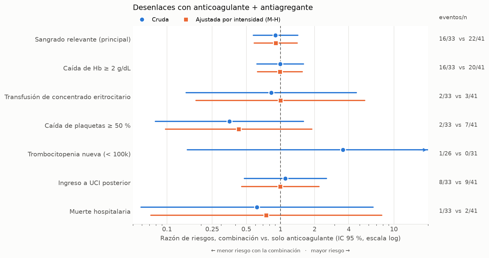

# Resultados

Generado por `python -m antitromboticos.analisis`. Combinación = anticoagulante + antiagregante; comparador = solo anticoagulante. |DME| = diferencia de medias estandarizada (> 0.10 sugiere desbalance). Riesgos con IC de Wilson; diferencia con IC de Wald; RR con IC logarítmico (corrección de Haldane si un grupo tiene 0 eventos); RR de Mantel-Haenszel combinado entre estratos de intensidad.

## Tabla 1. Características basales

| Característica | Combinación | Solo anticoagulante | |DME| |
|---|---|---|---|
| n | 33 | 41 |  |
| Edad, años | 66.0 [60.0–78.0] | 55.0 [46.0–65.0] | 0.72 |
| Mujeres | 12 (36 %) | 23 (56 %) | 0.40 |
| Estrato: médico | 17 (52 %) | 25 (61 %) | 0.19 |
| Estrato: quirúrgico | 11 (33 %) | 14 (34 %) | 0.02 |
| Estrato: cirugía cardiaca | 5 (15 %) | 2 (5 %) | 0.35 |
| En UCI en la fecha índice | 14 (42 %) | 27 (66 %) | 0.48 |
| Anticoagulación terapéutica | 9 (27 %) | 5 (12 %) | 0.39 |
| Anticoagulante: HNF | 29 (88 %) | 39 (95 %) | 0.26 |
| Anticoagulante: Enoxaparina | 1 (3 %) | 0 (0 %) | 0.25 |
| Anticoagulante: Warfarina | 3 (9 %) | 1 (2 %) | 0.29 |
| Anticoagulante: DOAC | 0 (0 %) | 1 (2 %) | 0.22 |
| Fibrilación auricular | 13 (39 %) | 8 (20 %) | 0.45 |
| Cardiopatía isquémica | 16 (48 %) | 6 (15 %) | 0.78 |
| Tromboembolia venosa | 1 (3 %) | 3 (7 %) | 0.19 |
| Insuficiencia cardiaca | 7 (21 %) | 6 (15 %) | 0.17 |
| Plaquetas basales (×10⁹/L) | 222.0 [169.0–267.0] | 216.0 [163.0–325.0] | 0.19 |
| Hb basal (g/dL) | 12.2 [10.7–13.9] | 11.5 [10.4–12.9] | 0.38 |
| Días de seguimiento | 5.2 [3.3–9.4] | 7.7 [4.6–12.6] | 0.36 |

## Tabla 2. Desenlaces binarios

| Desenlace | Estrato | Combinación, % (IC 95 %) | Solo AC, % (IC 95 %) | Diferencia, pp (IC 95 %) | RR (IC 95 %) |
|---|---|---|---|---|---|
| Sangrado relevante (principal) | Todos | 48 % (33–65) | 54 % (39–68) | -5 (-28 a +18) | 0.90 (0.57–1.42) |
| Sangrado relevante (principal) | profilactica | 54 % (35–72) | 50 % (34–66) | +4 (-22 a +30) | 1.08 (0.66–1.77) |
| Sangrado relevante (principal) | terapeutica | 33 % (12–65) | 80 % (38–96) | -47 (-93 a +0) | 0.42 (0.15–1.16) |
| Sangrado relevante (principal) | Mantel-Haenszel |  |  |  | 0.91 (0.59–1.40) |
| Caída de Hb ≥ 2 g/dL | Todos | 48 % (33–65) | 49 % (34–64) | +0 (-23 a +23) | 0.99 (0.62–1.59) |
| Caída de Hb ≥ 2 g/dL | profilactica | 54 % (35–72) | 44 % (30–60) | +10 (-16 a +35) | 1.22 (0.73–2.05) |
| Caída de Hb ≥ 2 g/dL | terapeutica | 33 % (12–65) | 80 % (38–96) | -47 (-93 a +0) | 0.42 (0.15–1.16) |
| Caída de Hb ≥ 2 g/dL | Mantel-Haenszel |  |  |  | 0.99 (0.63–1.55) |
| Transfusión de concentrado eritrocitario | Todos | 6 % (2–20) | 7 % (3–19) | -1 (-13 a +10) | 0.83 (0.15–4.67) |
| Transfusión de concentrado eritrocitario | profilactica | 8 % (2–26) | 8 % (3–22) | +0 (-14 a +14) | 1.00 (0.18–5.55) |
| Transfusión de concentrado eritrocitario | terapeutica | 0 % (0–30) | 0 % (0–43) | +0 (IC no estimable) | — |
| Transfusión de concentrado eritrocitario | Mantel-Haenszel |  |  |  | 1.00 (0.18–5.55) |
| Caída de plaquetas ≥ 50 % | Todos | 6 % (2–20) | 17 % (9–31) | -11 (-25 a +3) | 0.35 (0.08–1.60) |
| Caída de plaquetas ≥ 50 % | profilactica | 8 % (2–26) | 19 % (10–35) | -11 (-28 a +6) | 0.43 (0.10–1.89) |
| Caída de plaquetas ≥ 50 % | terapeutica | 0 % (0–30) | 0 % (0–43) | +0 (IC no estimable) | — |
| Caída de plaquetas ≥ 50 % | Mantel-Haenszel |  |  |  | 0.43 (0.10–1.89) |
| Trombocitopenia nueva (< 100k) | Todos | 4 % (1–19) | 0 % (0–11) | +4 (-4 a +11) | 3.56 (0.15–83.75) |
| Trombocitopenia nueva (< 100k) | profilactica | 5 % (1–23) | 0 % (0–12) | +5 (-4 a +14) | 3.95 (0.17–92.49) |
| Trombocitopenia nueva (< 100k) | terapeutica | 0 % (0–43) | 0 % (0–56) | +0 (IC no estimable) | — |
| Trombocitopenia nueva (< 100k) | Mantel-Haenszel |  |  |  | — |
| Ingreso a UCI posterior | Todos | 24 % (13–41) | 22 % (12–37) | +2 (-17 a +22) | 1.10 (0.48–2.54) |
| Ingreso a UCI posterior | profilactica | 25 % (12–45) | 17 % (8–32) | +8 (-13 a +30) | 1.50 (0.55–4.11) |
| Ingreso a UCI posterior | terapeutica | 22 % (6–55) | 60 % (23–88) | -38 (-89 a +13) | 0.37 (0.09–1.53) |
| Ingreso a UCI posterior | Mantel-Haenszel |  |  |  | 1.00 (0.45–2.19) |
| Muerte hospitalaria | Todos | 3 % (1–15) | 5 % (1–16) | -2 (-11 a +7) | 0.62 (0.06–6.55) |
| Muerte hospitalaria | profilactica | 4 % (1–20) | 6 % (2–18) | -1 (-12 a +10) | 0.75 (0.07–7.82) |
| Muerte hospitalaria | terapeutica | 0 % (0–30) | 0 % (0–43) | +0 (IC no estimable) | — |
| Muerte hospitalaria | Mantel-Haenszel |  |  |  | 0.75 (0.07–7.82) |

## Tabla 3. Desenlaces continuos, mediana [RIC]

| Desenlace | Combinación | Solo anticoagulante |
|---|---|---|
| Caída máxima de Hb (g/dL) | 1.8 [0.8–3.0] | 1.9 [1.0–2.8] |
| Cambio de plaquetas al nadir (%) | -12.1 [-27.8–-1.4] | -21.2 [-33.1–-5.9] |
| Estancia desde la fecha índice (días) | 5.2 [3.3–9.4] | 7.7 [4.6–12.6] |

## Figura

